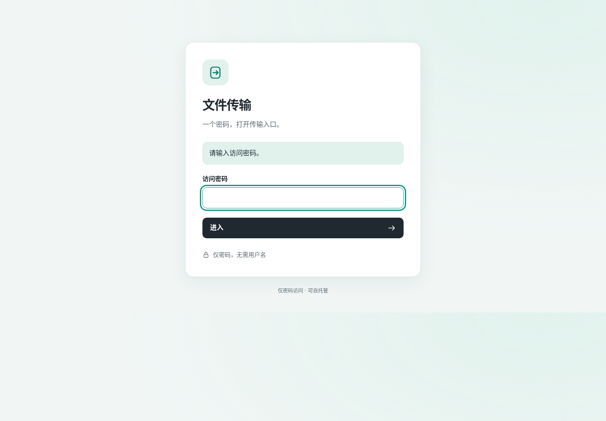
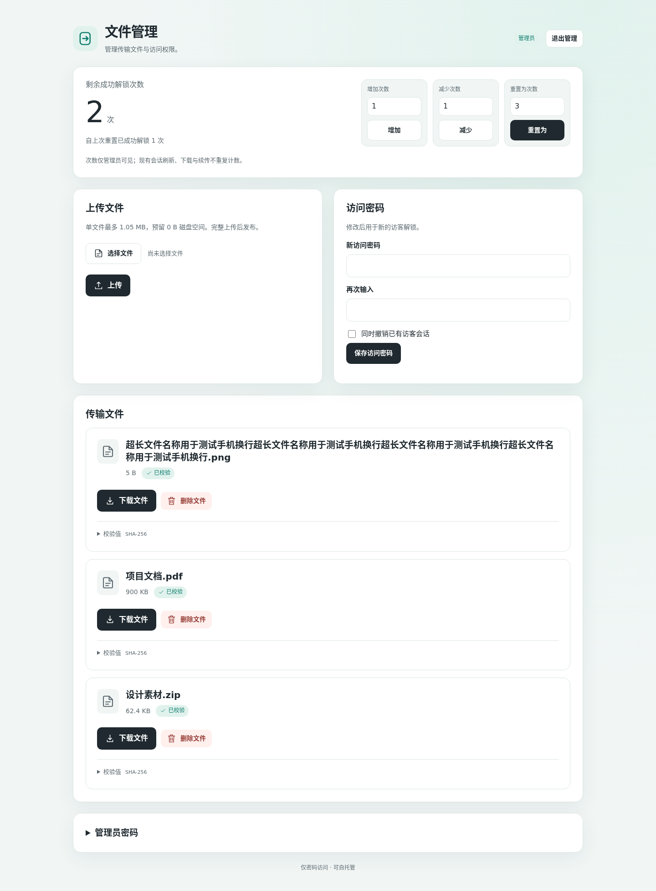

# File Transfer Gate

通用、仅密码解锁的文件传输网站。Python 标准库实现，无第三方运行依赖。访客输入访问密码下载文件；管理员在同一个密码框输入管理员密码进入后台。

页面不包含品牌、联系人或外部统计。仓库不包含传输文件、生产口令、会话数据库或私人激活链接。

## 界面

以下截图来自真实模板运行的隔离演示服务，使用虚构文件和独立数据库。





## 版本

- `v1.0.0`：原有只读单文件基线，标签保持不变。
- `v2.0.1`：管理后台、多文件上传/删除、密码及额度管理；大文件在启动前预校验，下载请求复用已校验结果。
- `v2.1.0`：与宣传片统一的浅色卡片和青绿色视觉；深色模式、文件大小自动换算、可折叠和复制的校验值、自定义选文件控件、突出显示的管理额度，以及原表单内的密码错误提示。

请部署固定标签或提交。Docker 基础镜像和 GitHub Actions 均固定到摘要/提交。升级前备份一致性的 SQLite 和 `config.json`；v2 状态不能交给旧版本直接运行。

## 快速开始

需要 Python 3.10+、独立可写的文件/状态目录和 HTTPS 反向代理。

```sh
mkdir data state
python -B transfer_server.py init --state ./state
python -B transfer_server.py serve --enable-admin --state ./state --files ./data --origin https://files.example.com
```

`init` 交互读取访问密码，拒绝覆盖已有配置。自动化支持 `--password-stdin`；不要把口令写在命令行或提交到 Git。

服务默认监听 `127.0.0.1:8080`，将 `Caddyfile.example` 换成自己的域名。`--origin` 必须等于公网 HTTPS Origin。

首次在服务器本地执行：

```sh
python -B transfer_server.py admin-bootstrap --state ./state
```

命令输出私密 token 和失效时间。仅由站点所有者打开：

```text
https://files.example.com/admin/activate/<token>
```

然后在首页输入初始管理员密码 `cosine123`，设置至少 12 位、不同于访问密码的新管理员密码。设置完成后，直接在普通首页密码框输入新管理员密码即可进入后台。

**公开默认密码不能单独激活后台。** 私密激活链接有效 24 小时，GET 不消耗，正确首次登录后失效；浏览器激活 Cookie 有效 10 分钟。首次设置会话只能改管理员密码或退出，不能改额度、访问密码、上传、下载或删除文件。若未完成首次设置，可本地重新执行 `admin-bootstrap`，旧链接及初始化会话立即失效。初始化后该命令拒绝重置管理员密码；丢失密码需要受控的服务器维护，网站不提供默认口令后门。

## 后台功能

- 修改访问密码，可选同时撤销已有访客会话；默认保留已有下载会话。
- 修改管理员密码，需要当前管理员密码，保存后撤销其他管理员会话。
- 上传多个文件，显示进度并可取消；完成写入、刷新和 SHA-256 校验后发布。
- 删除指定文件，删除前确认；旧地址停止提供，失败保留待处理记录，可重试。
- 增加、减少或重置剩余成功解锁次数。重置可以指定 0–1000000，并保存为下次 CLI 重置目标。
- 查看未完成上传并显式清理已确认身份的残留文件。

管理员会话有效 8 小时；口令和会话均不保存明文。管理操作要求独立管理员会话、同源 Origin 和会话绑定 CSRF；普通下载会话不能提升权限。

## 计数规则

新站点默认三次成功访客解锁：正确访问密码、成功创建新访客会话才扣一次。错误密码不扣次数；同一有效会话刷新、下载、续传和再次输入访问密码不重复扣除。管理员登录和管理操作不消耗访客次数。

访客不显示剩余次数；额度耗尽时显示联系管理员，仍可在同一密码框登录管理员。现有访客会话继续有效；改密码时可主动撤销。撤销影响之后的请求，已经开始的下载可能继续完成。

额度、会话、文件目录、凭据版本和管理事件存于 SQLite，重启不自动重置。CLI 幂等重置：

```sh
python -B transfer_server.py reset --state ./state --operation-id manual-reset-001
# 如需撤销旧访客会话，加 --revoke-sessions
```

同一 operation ID 重复执行不会重复补充额度。管理网页上的每次点击是一次独立操作。

## 上传、存储与恢复

默认单文件上限 **4 GiB**，预留 **1 GiB** 磁盘空间，单次仅允许一个上传；可用 `--max-upload-bytes` / `--reserve-bytes` 调整。前端原始文件流上传，服务端按块读取，不把整个文件载入内存。超过上限或空间不足时拒绝发布；取消和断线不会生成可下载的半成品。当前不提供上传断点续传。

页面按十进制自动显示 B / KB / MB / GB 等单位（例如 4 GiB 显示为 4.29 GB），参数和实际字节限制不变。上传进度来自浏览器真实传输事件，完成传输后等待服务器校验并发布；下载使用浏览器原生下载管理器，页内不提供模拟下载进度。

校验值默认折叠，点开后可复制完整 SHA-256；浏览器限制自动复制时会选中校验值供手动复制。复制与选文件使用本地 JavaScript，不发送额外请求。页面样式在 `static/app.css`，共享交互在 `static/app.js`，管理上传在 `static/admin.js`，HTML 组件在 `ui.py`；所有资源同源提供，没有外部字体或前端运行依赖。禁用 JavaScript 后仍可登录、查看校验值和使用浏览器下载，管理上传需要 JavaScript。

文件使用随机内部名，原文件名仅用于展示和下载响应。仅服务 SQLite 中已发布的文件，禁止目录枚举或任意路径操作；拒绝符号链接、路径分隔符、控制字符和文件身份变化。下载地址绑定文件完整 SHA-256，支持 Range/If-Range、HEAD 和 Unicode 文件名。

同名同 SHA 的上传复用已发布记录；同名不同内容保留独立地址。首次读取及身份变化时检查完整性，不能原地编辑托管文件。删除先阻断目录记录，再尝试物理删除；Linux 已打开的下载句柄可能继续完成，Windows 忙碌文件会保留待处理状态。重启不会从旧清单复活已删除文件。

上传意图、内容刷新和业务提交分阶段协调；崩溃遗留 `writing` 记录在重启后标记 `interrupted`，不会自动发布。未知身份的残留拒绝自动删除，须由服务器维护人员核对。SQLite 必须在可靠本地文件系统上，备份包括一致性数据库和文件内容；不宣称抵抗任意磁盘损坏或断电。

## 从 v1 升级

停止旧实例、备份数据库和配置，用 `--enable-admin` 启动新实例，并保留旧 `--manifest`：

```sh
python -B transfer_server.py serve --enable-admin --state ./state --files ./data --manifest ./data/current.json --origin https://files.example.com
```

初次启动在 SQLite 事务中导入旧访问口令校验值、已用次数和会话；不重置额度。第一次导入并校验清单中的文件，之后以数据库目录为准。后台密码修改不会回写旧配置作为降级入口。关闭后台模式不能打开已迁移数据库。

`--legacy-session-cookie` / `--legacy-csrf-cookie` 支持旧 Cookie 迁移；`--legacy-download PATH=SHA256` 只允许匹配当前已发布摘要的旧地址，文件已删除或换内容后返回 410。默认关闭。

v1 轻量模式继续支持：不加 `--enable-admin`，必须提供 `--manifest`，文件目录可只读；没有公网管理功能。

## Docker

```sh
mkdir -p data state
cp .env.example .env
# 编辑 PUBLIC_ORIGIN；仅为本项目独立目录授予写权限。
sudo chown 10001:10001 data state
docker compose build
docker compose run --rm file-transfer init --state /state
docker compose up -d
docker compose run --rm file-transfer admin-bootstrap --state /state
```

容器 UID/GID `10001:10001`，根文件系统只读、无 capabilities；仅专用 data 和 state 目录可写。示例内存上限 128 MiB、CPU 0.25、最多八个工作线程；只发布到主机回环地址。已有共享反向代理时，可改用专用 Docker 私网且不发布端口。

不要把其他项目目录、SSH 凭据、Docker socket 或整个磁盘挂入后台。反向代理上传 body 上限与应用上限保持一致，小型表单限制 16 KiB。只有代理覆盖 `X-Real-IP` 且后端无法被任意客户端直接访问时启用 `--trust-proxy`。

日志仅记录方法、状态和传输统计，不记录请求路径、口令、Cookie、激活 token、文件正文或 IP；共享代理也不要额外记录私密激活 URL。

## 测试

```sh
python -B -m unittest discover -s tests -v
node --test tests/frontend.test.cjs
```

保留 v1 回归，并覆盖管理员初始化、权限隔离、密码版本及撤销、额度并发、CSRF/Origin、上传失败和发布、文件身份、删除后重启不复活、Range、真实子进程重启和明文凭据扫描。Windows 无符号链接权限时对应测试明确跳过。

前端回归使用 Node.js 内置测试器（仅测试需要 Node.js，无 npm 依赖），验证真实上传进度事件、失败/取消后重试、文件名展示、复制及手动复制回退。Python 回归同时检查大小换算、表单错误不回显密码、同源静态资源、安全策略和明暗主题普通文字对比度。

## 边界与 License

这是受信任管理员管理的文件传输入口，不是用户注册网盘或端到端加密存储。服务器维护者可读取传输文件；访客取得的副本仍可传播。管理员默认密码以私密首次激活限定，不可把示例密码长期用于公网管理。

MIT；传输文件权利由各自权利方决定。
